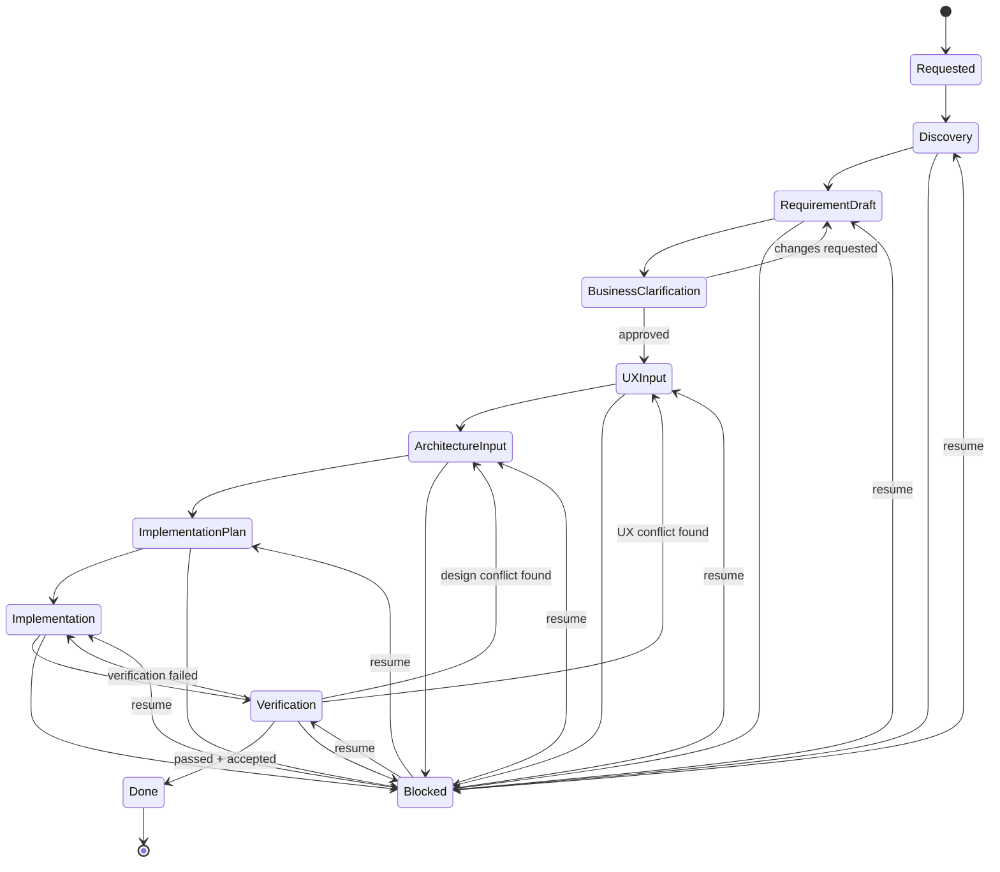

# Multi-Agent Delivery Workflow

A stage-gate state machine for taking a work item from raw request to shipped
and verified change, driven by five role-based agents plus human checkpoints.

## Reference standard

Rather than invent a bespoke process, this combines three well-established
models so each state has a real precedent instead of a made-up label:

- **ISO/IEC/IEEE 12207** (software life-cycle processes) — the stage-gate
  backbone: every state has explicit entry/exit criteria, and a state is not
  "done" until its exit criteria are met, not just when an agent stops typing.
- **BABOK** (Business Analysis Body of Knowledge) — the requirements split
  into *elicitation* (Discovery), *requirement drafting*, and *stakeholder
  validation* (Business Clarification), instead of one big "requirements" blob.
- **Design Council Double Diamond** — Discovery/Requirement Draft is the first
  diamond (diverge to understand the problem, converge on a requirement), and
  UX Input/Architecture Input/Implementation Plan is the second (diverge on
  solution options, converge on a build plan).

## States

Exactly the pipeline requested, plus the minimum machinery needed to make it
real: an `Implementation` state (someone has to write the code between "plan"
and "verification"), and one reusable `Blocked` state instead of a bespoke
human-gate for every stage.



`Blocked` is not a pipeline stage — it's a pause. Any agent can push a work
item into `Blocked` with a question and a `resume_state`; a human answers in
`clarifications.md`; the Orchestrator resumes the item at `resume_state`. This
covers "human clarification needed" everywhere without a named gate per stage.

`BusinessClarification` stays a named state (not folded into `Blocked`)
because it's a mandatory checkpoint the user asked for explicitly — every
requirement draft must clear stakeholder sign-off before anyone designs
against it, not just an optional escape hatch.

## State table

| State | Owner agent | Reads | Produces | Exit criteria | Next |
|---|---|---|---|---|---|
| `Requested` | Orchestrator (intake only) | — | `request.md`, `item.yaml` | Request has a title + one-paragraph problem statement | `Discovery` |
| `Discovery` | Delivery Planner | `request.md`, `knowledge/components/`, `knowledge/domain/` | `discovery.md` | Existing systems/constraints/similar work identified | `RequirementDraft` |
| `RequirementDraft` | Delivery Planner | `discovery.md` | `requirements.md` (draft) | Requirements are structured (business/stakeholder/solution, per BABOK) and internally consistent | `BusinessClarification` |
| `BusinessClarification` | **Human** (business/product stakeholder) | `requirements.md` | `clarifications.md`, `requirements.md` (approved) | Stakeholder signs off, or sends back with changes | `UXInput` or back to `RequirementDraft` |
| `UXInput` | UX Designer | `requirements.md`, `knowledge/patterns/` (tag `ux`) | `ux-spec.md` | Flows cover every requirement; accessibility notes present; reuses existing patterns or justifies a new one | `ArchitectureInput` |
| `ArchitectureInput` | Solution Architect | `requirements.md`, `ux-spec.md`, `knowledge/decisions/`, `knowledge/patterns/` (tag `architecture`), `knowledge/anti-patterns/` | `architecture.md` | Components, data model, integration points, risks all named; conforms to accepted decisions or explicitly proposes superseding one; doesn't re-propose a known anti-pattern | `ImplementationPlan` |
| `ImplementationPlan` | Delivery Planner | `architecture.md`, `ux-spec.md` | `implementation-plan.md` | Ordered task list with dependencies; each task traces to a requirement | `Implementation` |
| `Implementation` | Implementer | `implementation-plan.md` | code changes, `implementation-log.md` | All planned tasks either done or explicitly re-scoped | `Verification` |
| `Verification` | Implementer (self-check) | code changes, `architecture.md`, `ux-spec.md`, `knowledge/decisions/`, `knowledge/anti-patterns/` | `verification-report.md` | Build/tests/lint pass **and** report shows conformance to architecture + UX spec + accepted project decisions **and** documentation hygiene checklist complete (see below) **and** human accepts | `Done`, or back to `Implementation`/`ArchitectureInput`/`UXInput` on failure |
| `Blocked` | Orchestrator (routing only) | `clarifications.md` | updated `clarifications.md` | Human has answered the open question | `resume_state` |
| `Done` | Orchestrator (closeout only) | `verification-report.md`'s hygiene checklist | closing `item.yaml` history entry | Hygiene checklist confirmed complete | terminal |

## Rework rules

- `Verification` failing tests/build/lint → back to `Implementation` (same plan, fix the code).
- `Verification` finding the code doesn't match the plan because the **plan** was wrong architecturally → back to `ArchitectureInput`.
- `Verification` finding a UX mismatch (flow doesn't match spec, or spec was wrong) → back to `UXInput`.
- `BusinessClarification` rejecting the draft → back to `RequirementDraft`.
- Every backward transition appends a note to `item.yaml`'s history — never silently overwrite the previous artifact version, append a new one.

## Directory layout

```
work-items/<id>-<slug>/    # ephemeral, one-per-item — see state table above
  item.yaml               # status, owner, history, blocked question if any
  request.md
  discovery.md
  requirements.md
  clarifications.md
  ux-spec.md
  architecture.md
  implementation-plan.md
  implementation-log.md
  verification-report.md
knowledge/                 # persistent, project-wide — see "Project-level knowledge" below
  index.md
  log.md
  decisions/
  patterns/
  anti-patterns/
  domain/
  components/
templates/                 # blank template per artifact + per knowledge concept type
  knowledge/
.claude/agents/
  orchestrator.md
  delivery-planner.md
  ux-designer.md
  solution-architect.md
  implementer.md
```

## Project-level knowledge (OKF)

Work-item artifacts (above) describe *one change*. But agents also need the
current state of the *project* — what's already been decided, what pattern
to reuse, what's already been rejected — so a new work item doesn't
contradict or re-litigate settled ground. That state lives in `knowledge/`,
a bundle conforming to **OKF (Open Knowledge Format)**: a directory of
markdown files with YAML frontmatter, no schema registry, readable with
`cat`, diffable in git.

Each concept file is one markdown doc with a required `type` field
(`Architecture Decision`, `Pattern`, `Anti-pattern`, `Domain Concept`, or
`Component`), optional `tags`/`description`/`resource`/`timestamp`, and a
free-form body. `index.md` in each subdirectory gives progressive
disclosure (list what exists before opening any one file); `log.md` at the
bundle root gives a chronological history of what changed and why.

**Read duty** — before proposing anything, an agent checks the categories
relevant to its state (see the "Reads" column above): Delivery Planner
checks `components/`+`domain/` during Discovery so it doesn't re-derive
what already exists; UX Designer checks `patterns/` (tag `ux`) so it reuses
instead of reinventing; Solution Architect checks `decisions/`+`patterns/`
(tag `architecture`)+`anti-patterns/` so it doesn't contradict an accepted
decision or re-propose something already rejected.

**Write duty** — not everything in a work item is worth promoting. The
test: *would a future work item need to know this to avoid contradicting
it?* If yes:
- A new cross-cutting architecture choice → new `decisions/<slug>.md`
  (`status: proposed` or `accepted`).
- An alternative rejected for a reason that will recur → new
  `anti-patterns/<slug>.md`, citing the work item.
- A reusable UX or architecture approach → new `patterns/<slug>.md`.
- A new shared term → new `domain/<slug>.md`.
- A new system/module → new `components/<slug>.md`.

If not, it stays local to the work item's own artifact — most decisions
are just that decision, not a rule for everything after it.

**Superseding an accepted decision** is a one-way-door change: an agent
proposing it does not just overwrite the old file. It sets `status:
superseded` on the old concept, links it to the new one, and — because
overturning settled architecture affects work beyond the current item —
raises `blocked` for human sign-off rather than deciding alone.

Every write appends one entry to `knowledge/log.md`.

### Documentation hygiene checklist (part of `Verification`, before `Done`)

Promotion during Discovery/UX Input/Architecture Input happens *before* the
code exists — it can go stale by the time implementation actually lands.
Without a closing check, drift and half-finished promotions accumulate
silently. So `Verification` isn't just "does the code work" — before the
Implementer can report `pass`, it confirms, and records in
`verification-report.md`:

1. **Promotions completed** — anything Discovery/UX Input/Architecture Input
   flagged for `knowledge/` was actually written, not just noted as a TODO.
2. **Promotions reconciled** — if implementation ended up diverging from
   `architecture.md`/`ux-spec.md` in a small way that didn't trigger a full
   rework loop (e.g. a component was split differently than planned), the
   relevant `knowledge/` concept and the work item's own artifact are
   updated to match what actually shipped, not what was planned.
3. **New components captured** — anything genuinely new created during
   implementation gets a `knowledge/components/<slug>.md` entry with a real
   `resource` path, if a future Discovery would need to find it.
4. **No dangling `Blocked`** — `clarifications.md` has no open question left
   unanswered for this item.
5. **`knowledge/log.md` entries exist** for every promotion made anywhere in
   this item's lifecycle.

This is a checklist, not new content to author from scratch — most items
touch zero or one of these. The Orchestrator's only job at `Done` is to
confirm the checklist is marked complete in `verification-report.md` and
write the closing `item.yaml` history entry; it does not re-derive or
second-guess the content.

## Orchestrator routing table

The Orchestrator never writes an artifact. It reads `item.yaml.status`, invokes
the owning agent (or waits on a human for `BusinessClarification`/`Blocked`),
and writes the resulting `status` back.

| Current status | Action | Invoke |
|---|---|---|
| `requested` | create work item folder from `request.md` | none (intake) |
| `discovery` | dispatch | Delivery Planner |
| `requirement_draft` | dispatch | Delivery Planner |
| `business_clarification` | notify human, wait | — |
| `ux_input` | dispatch | UX Designer |
| `architecture_input` | dispatch | Solution Architect |
| `implementation_plan` | dispatch | Delivery Planner |
| `implementation` | dispatch | Implementer |
| `verification` | dispatch | Implementer, then wait for human acceptance |
| `blocked` | notify human, wait | — |
| `done` | confirm hygiene checklist in `verification-report.md` is complete, write closing `item.yaml` history entry, stop dispatching | — |

Because a spawned subagent generally cannot itself spawn subagents, the
Orchestrator role is meant to be run by the **top-level session** (guided by
`orchestrator.md` below) — not invoked as a nested subagent — unless your
Claude Code setup grants the `Task` tool to custom agents.
